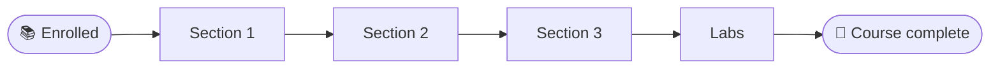

# Intro To Red Team — HackTheBox Course Notes


> My notes, commands and lab walkthroughs from the HackTheBox **Intro To Red Team** course.
> Lab answers are hidden behind spoiler sections. Try them yourself first.

---

## 📑 Table of Contents
- [Overview](#-overview)
- [Learning Roadmap](#️-learning-roadmap)
- [Progress Tracker](#-progress-tracker)
- [Module Notes](#-module-notes)
- [Lab Writeups](#-lab-writeups)
- [Cheatsheets](#-cheatsheets)
- [Key Takeaways](#-key-takeaways)

---

## 🧭 Overview

| Item | Detail |
|------|--------|
| Course | Intro To Red Team |
| Platform | HackTheBox |
| Enrolled | 2026-10-25 |
| Completed | _TBD_ |
| Certificate | _TBD_ |

---

## 🗺️ Learning Roadmap



> _Update the nodes with the real section names as I go._

---

## ✅ Progress Tracker

| # | Section | Notes | Status |
|---|---------|-------|--------|
| 1 | _TBD_ | [notes/01-section.md](notes/01-section.md) | ⬜ Not started |

Legend: ⬜ Not started · 🟨 In progress · ✅ Done

---

## 📝 Module Notes

<details>
<summary><b>1. _Section name_</b></summary>

**Concepts**
- 

**Commands**
```bash
# 
```

<details>
<summary>🚩 Click to reveal lab answer</summary>

`answer here`

</details>
</details>

---

## 🧪 Lab Writeups

Full interactive machine walkthroughs completed during the course.

| Machine | Difficulty | Foothold | Privesc | Writeup |
|---------|-----------|----------|---------|---------|
| Cap | Easy | IDOR → pcap FTP creds | `cap_setuid` on python3.8 | [writeups/cap.md](writeups/cap.md) |

---

## 📋 Cheatsheets

- [cheatsheets/commands.md](cheatsheets/commands.md): commands collected throughout the course

---

## 💡 Key Takeaways

- 

---

<sub>Notes for educational purposes only. Only test systems you're authorized to attack.</sub>
